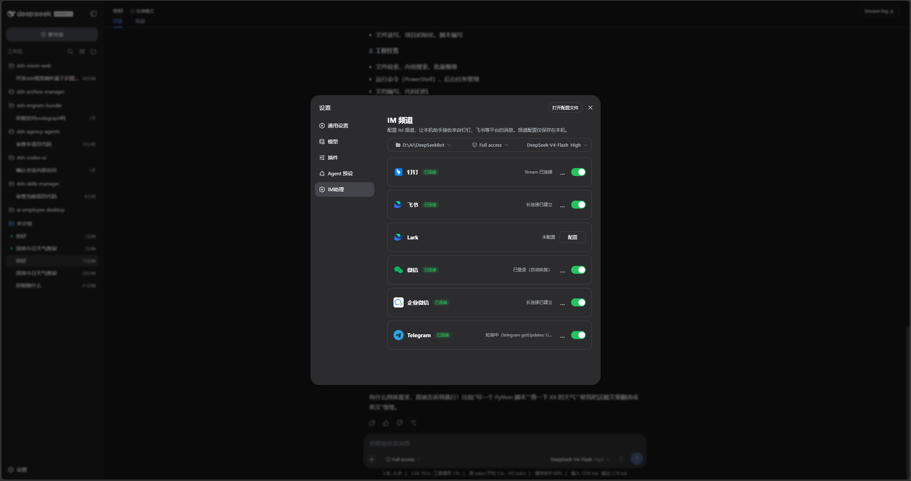
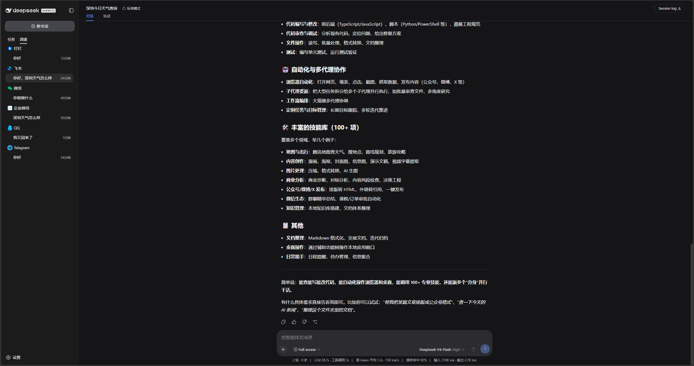
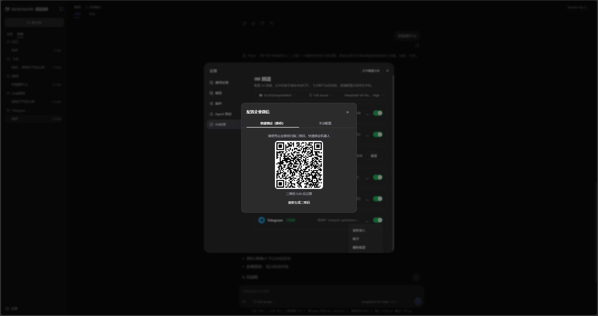
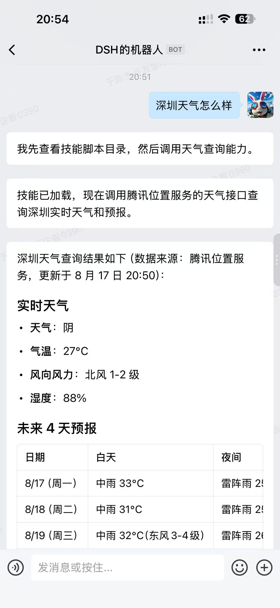
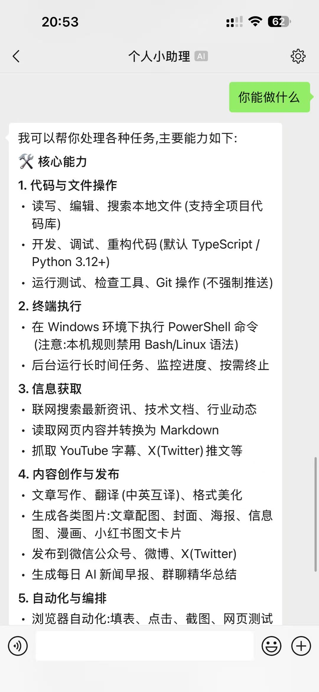
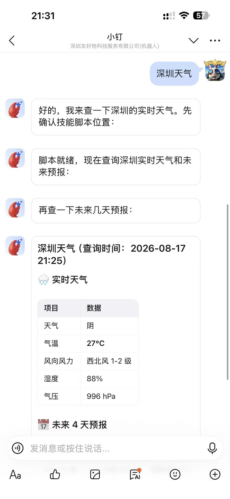
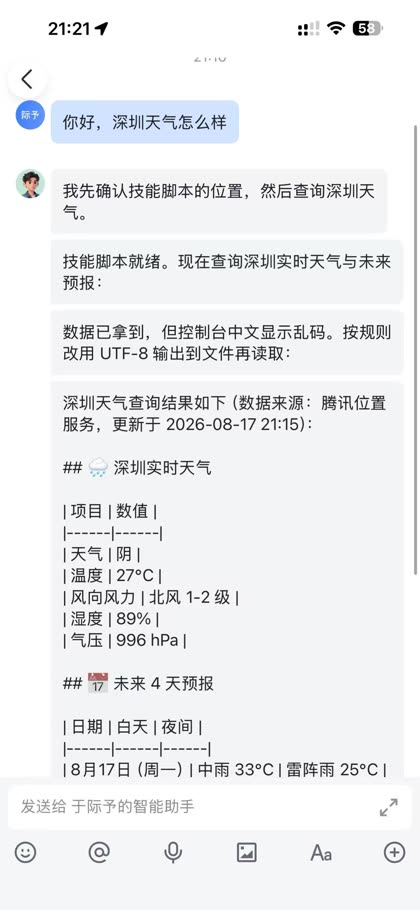
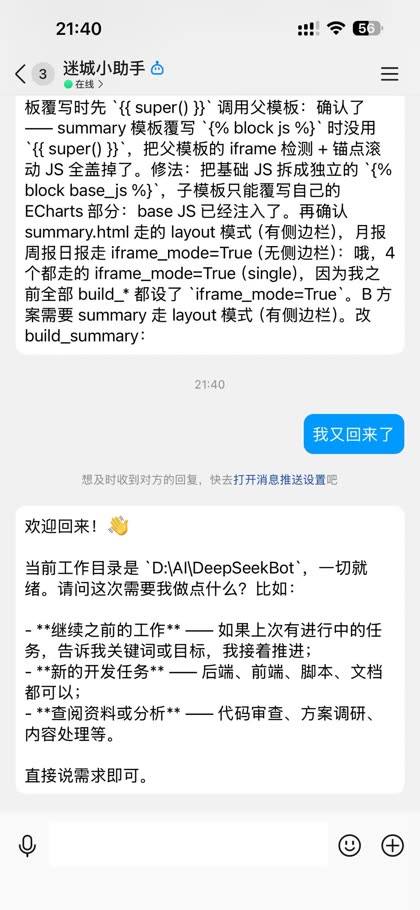
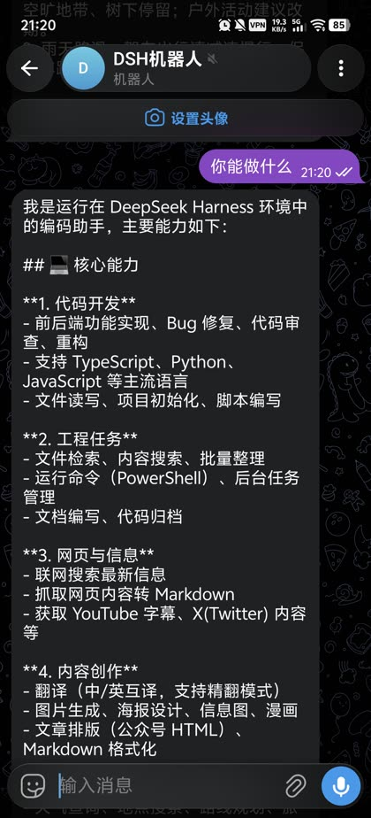

<p align="center">
  
</p>

<div align="center">

# DSH Session Secretary · 会话秘书

  **DeepSeek Harness 的会话管理秘书 —— 会话需要你时通过 IM 找到你，让你在聊天里管好每一个会话**

  [English](README.md) · [更新日志](CHANGELOG.zh-CN.md) · [Apache-2.0](LICENSE)

  [](LICENSE)
  [](https://github.com/MichengAI/dsh-im-connect)
  [](https://nodejs.org/)
  [](#-支持的渠道)
  [](https://github.com/MichengAI/dsh-im-connect)
</div>

> 本项目 fork 自 [DSH IM Connect](https://github.com/MichengAI/dsh-im-connect)，但目标不同：做**会话的秘书**，而不只是 IM 桥接器。仓库持续跟进上游并定期合并其更新。

## 这个项目是什么

你会同时跑多个 DeepSeek Harness（DSH）会话——长任务、后台 Agent、等待审批的计划。你不可能一直盯着它们。会话秘书替你做三件事：

1. **盯着会话，主动找你** —— 会话向你提问、等待工具审批、回合完成或任务出错时，秘书把通知送到桌面弹窗和/或你的即时通讯里，并附上一段可读的摘要。
2. **通过 IM 回话** —— 直接在聊天里回答问题、批准工具、补充指令。两阶段代答保证序号确认不误触：秘书先转发，你回复序号确认，它才执行。
3. **在聊天里管理会话** —— 把任意会话绑定到聊天、互相切换、新建会话，用命令驱动（`/menu`、`/stop`、`/model`……）。未绑定聊天里的纯文本先由 AI 解析成意图（打开 / 新建 / 追问），并以 `[1] 确认 [2] 取消` 的形式跟你确认后再执行。

IM 渠道是秘书的「嗓子」，不是目的。目的是：每一个会话都能在正确的时刻，通过你手机上已经打开的那款聊天软件，找到对的人。

## 功能特性

- **会话通知（秘书核心）**：任意会话的提问与审批请求转发到控制聊天；未绑定 IM 聊天的会话在回合完成/出错时发通知；可选桌面系统弹窗（Windows 通知中心）。
- **控制聊天自动学习**：可以在配置里固定，也可以在任意已连接渠道给机器人发一条私聊——秘书自动学习，之后的全部通知与确认都发到这里。
- **AI 意图解析**：未绑定任何会话的私聊里，纯文本先由无头 Agent 解析为「打开会话 N / 新建会话 / 追问」，确认后才动会话。
- **来源标注**：IM 回复带 `【项目·会话】` 前缀，多个会话喂进同一个群聊也能分清谁在说话。
- **IM 控制台（继承自上游并持续同步）**：9 大消息平台、账号级工作区/模型/权限、斜杠命令、操作菜单、交互审批、分段回复、任务树过滤、投递补发——详见下文参考章节。
- **一切都在本机**：设置、学习到的控制聊天、凭据都保存在插件状态目录；通知只走你配置过的渠道出去。

## 谁可以驱动助手

入站消息先看发送者，再处理命令、工具审批和注入。

| 场景 | 行为 |
| --- | --- |
| 群聊未 @ 当前机器人 | 忽略，不回复、不进待批准；只 @ 其他成员也不触发 |
| 群聊已准确 @ 当前机器人 | 不用绑定，任何人都可以下任务 |
| 私聊 · 扫码用户 | 微信 / 飞书 / Lark / QQ 扫码者自动进白名单，可直接对话 |
| 私聊 · 其他人 | 进入设置页待批准；不批准就不能驱动助手 |
| 私聊 · 扫码不返回身份 | 钉钉 / 企微的快捷绑定只返回机器人凭据，扫码者仍需在设置页批准 |
| 私聊 · 手动凭据 | Telegram、Discord、Slack，以及手动填写凭据的钉钉 / 企微 / QQ，所有私聊都要先批准 |
| 私聊缺少 userId | 拒绝 |
| 工具审批 | 在绑定该会话的聊天里回复「批准 / 拒绝」；群聊和私聊都可以，不用去网页。5 分钟内未回复按取消结束，期间其他文字不会进入下一轮 |
| 交互选择 | 在原 IM 会话回复选项序号或文字；多选用逗号分隔，也可补充自定义答案；群聊只接受任务发起者回答 |

微信是扫码渠道且只支持私聊，所以连上后用**同一个微信号**即可直接用。换一个微信号私聊，会出现在设置页待批准。

## 📡 支持的渠道

<p align="center">
  <code>🔔 钉钉</code>&nbsp;
  <code>🐦 飞书</code>&nbsp;
  <code>🌐 Lark</code>&nbsp;
  <code>💬 微信</code>&nbsp;
  <code>🏢 企业微信</code>&nbsp;
  <code>🐧 QQ</code>&nbsp;
  <code>✈️ Telegram</code>&nbsp;
  <code>🎮 Discord</code>&nbsp;
  <code>🧩 Slack</code>
</p>

| 渠道 | 状态 | 接入方式 | 需要 |
| --- | --- | --- | --- |
| 🔔 **钉钉** | ✅ 可用 | 扫码，或 Client ID / Secret | 钉钉开放平台机器人；回复优先走 AI Card |
| 🐦 **飞书** | ✅ 可用 | 扫码（自动创建机器人），或 App ID / App Secret | 飞书账号，或自建机器人凭据 |
| 🌐 **Lark** | ✅ 可用 | 扫码，或 App ID / App Secret | Lark 国际版账号，或自建机器人凭据 |
| 💬 **微信** | ✅ 可用* | 官方 iLink 扫码 | 建议专用小号；仅私聊 |
| 🏢 **企业微信** | ✅ 可用 | 扫码（推荐），或 Bot ID / Secret | 企业微信智能机器人 |
| 🐧 **QQ** | ✅ 可用 | 扫码，或 AppID / AppSecret | QQ 开放平台机器人，不是个人号 |
| ✈️ **Telegram** | ✅ 可用 | 仅填 Bot Token | `@BotFather`；同一 Bot 不要同时开 Webhook |
| 🎮 **Discord** | ✅ 可用 | 仅填 Bot Token | Developer Portal 的官方 Bot。打开 Message Content Intent；文字频道和公告频道第一次 @ 后在 Thread 中继续，不必重复 @ |
| 🧩 **Slack** | ✅ 可用 | 填 Bot Token 与 App Token | api.slack.com 建应用并开启 Socket Mode。私聊直接回复，频道被 @ 后在该消息的线程里回复，线程内后续消息不必重复 @ |

✅ 可用 = 文字收发可用 ｜ *微信 = 只走腾讯官方 iLink，不做逆向个人号 ｜ 群聊都需要 @ 机器人才回复。Discord 仅文字频道和公告频道在 Bot 自己创建的 Thread 中免重复 @；Slack 在机器人已参与的消息线程中免重复 @

## 秘书偏好

秘书侧的一切都在 **设置 → 会话秘书** 页管理，保存即改即生效，无需重启：

| 偏好 | 默认 | 作用 |
| --- | --- | --- |
| 提问转发 | 开 | 会话的 `user-questions` 请求转发到控制聊天，可直接回复作答 |
| 审批转发 | 开 | 工具调用与计划审批转发到控制聊天 |
| 完成通知 | 开 | 回合正常结束且会话未绑定 IM 聊天时，发送 ✅ 摘要 |
| 出错通知 | 开 | 会话出错且未绑定聊天时，发送 ❌ 通知 |
| 【项目·会话】前缀 | 开 | IM 回复带所属项目与会话标识 |
| AI 意图解析 | 开 | 未绑定聊天里的纯文本先解析意图并序号确认 |
| 控制聊天 | 自动学习 | 显示「已固定 / 已自动学习 / 尚未学习」；**清除学习**可重置 |
| 代笔回复有效期 | 1440 分钟 | 序号确认与代答回复超时作废 |
| 转发截断长度 | 1200 字符 | 单条转发消息的最大长度 |
| 系统通知 | 开 | 桌面弹窗通道（node-notifier / SnoreToast）；详细程度 minimal/normal/detailed |

控制聊天也可以在配置文件里用 `secretary.controlChatId` 手工固定；自动学习只补空缺。这些偏好以覆盖层形式存放在 `channels.json`（`store.secretary`），插件配置只承担默认值，所以设置页保存后立即生效。

## 图片输入

图片输入使用与 DSH Chat 一致的模型能力和附件规则，不按模型名称猜测视觉能力：

覆盖微信、企业微信、钉钉、飞书、Lark、QQ、Telegram、Discord 和 Slack；具体平台消息形式和联调检查见[图片输入验收](docs/image-input.md)。

- 以当前 IM 会话实际使用的模型为准，而不是只看全局默认模型。
- 模型声明支持 `image` 时，将图片保存为 DSH 标准图片附件并提交给模型；会话记录保留图片引用，而不是只有本地文件路径文字。
- 模型明确不支持图片时，在 IM 提示切换模型，不静默丢图。模型未提供能力元数据时，遵循 Chat 的兼容规则，不仅因元数据缺失而拒绝。
- 图片仍受渠道下载限制、宿主附件大小与格式限制，以及原有私聊准入和群聊 @ 规则约束。
- 此功能是用户向机器人发送图片进行分析，不代表所有渠道都支持机器人发送图片或生成图片。

## 文件输入

微信、企业微信、钉钉、飞书、Lark、QQ、Telegram、Discord、Slack 可接收普通文件，并通过 Chat 的上传服务交给当前会话。可以发送 PDF、文档、表格等文件，再让助手读取或处理；能否解析具体格式与网页 Chat 的模型、工具和文件能力一致，不承诺每种格式都能直接理解。

- 需要支持的宿主（`>=0.2.0-rc.1 <0.3.0-0`）所提供的文件上传服务。早期版本与 `0.3.0` 代际破坏性更新由版本门拦截。
- 单条消息最多 4 个普通文件，累计最多 20 MiB，还受渠道下载限制约束。
- 文件先保存为 Chat 标准附件，通过当前会话专属的凭据提交；不把本地路径文字当作文件输入。
- 保留私聊准入与群聊提及规则；文件说明中的 `/new` 或“批准”属于普通内容，不执行命令或审批。
- 上传失败不提交部分正文，停用或重载账号后不继续向旧会话提交。支持回复后的文件产物回传。

## 文件回传

微信、企业微信、钉钉、飞书、Lark、QQ、Telegram、Discord 和 Slack 均可回传助手产出的文件。例如：“整理成 PDF 报告，并把文件发给我。”

- 使用 Chat 支持的文件工具成功新建或修改的文件，会在回复后发送；宿主支持 `present` 时，也会发送明确交付的文件，包括已有文件。
- 文件访问范围与 Chat 一致，允许宿主可读取的工作区外文件。不从回复正文中猜测文件路径；通过脚本等方式生成的文件，需要助手明确 `present` 交付。
- 已支持的宿主使用 Chat 完整文件下载服务及其配置的大小上限。目录和符号链接不发送，渠道自身的文件限制仍然适用。
- 单个文件发送失败会明确提示文件名，并继续处理其他文件；切走会话或停止账号后，不会把尚未投递的文件转发到其他聊天。
- 单独发送 `/export`，可将当前聊天绑定会话的 Chat ZIP 日志发回当前聊天（不含子会话）。ZIP 上限为 32 MiB；超限或发送失败时可在网页 Chat 使用 `/export` 下载。

## 操作菜单

有效点击后，支持更新的原卡片移除按钮，提示已选择；实际执行结果见后续回复。企业微信仅能在按钮回调窗口更新，过期卡片仍由服务端拒绝。`/status` 根据实际状态提供停止任务、暂停或恢复目标、查看队列等操作。

支持原生按钮的渠道发送 `/sessions`、`/workspaces`、`/models` 即可直接选择。分页后，回复序号或 `/session 序号`、`/workspace 序号`、`/model 序号` 对应当前选择页；文字渠道仍使用原列表序号。

发送 `/menu` 或 `/m`，可选择会话、工作区、模型和 Agent 预设，以及新建、停止、导出和查看状态。列表支持分页；点击按钮或回复当前菜单序号即可操作，普通文字退出菜单。

菜单提供上一页、下一页和返回入口；企业微信按卡片容量分页。会话、工作区和模型选择分别可直接发送 `/menu sessions`、`/menu workspaces`、`/menu models`；预设与推理可用 `/menu presets`、`/menu reasoning`。

钉钉、Telegram、Discord、Slack、飞书/Lark 使用原生按钮；企业微信在按钮数量和正文符合平台限制时使用卡片，其他情况及 QQ、微信使用文字序号。菜单按账号、聊天、操作者和会话隔离，15 分钟或重启后失效；执行时重新检查权限，旧按钮不能重复执行。

审批与问答复用上述原生按钮渠道。审批始终留在发起任务的聊天里，不会回退到网页端；5 分钟内没有批准或拒绝就按取消结束。群聊里只接受任务发起者批准，私聊没有额外限制，关闭命令不影响已有审批及问答。问题不设超时，下一句文字仍作为答案。

Agent 预设：`/presets` 查看目录，`/preset 序号或ID` 使用预设在当前工作区新建并切换会话，旧会话保留。推理等级：`/reasoning 序号` 设置等级，`/reasoning --default` 恢复默认。

IM 消息发起的处理结束后，会在正文和文件投递完成后给出一次结果提示，并提供最近记录、状态、会话导出和菜单入口。执行失败、停止和投递失败会分别说明；不会自动重跑任务或重发文件。

## 消息处理状态

普通聊天消息会随实际任务更新状态；命令仍使用文字回复。

- 钉钉：在原消息上显示排队、思考、等待确认、已完成、失败或取消标签。
- 飞书 / Lark：使用处理中、完成和失败表情；等待确认沿用处理中表情，取消时撤下表情。
- Telegram：使用 👀 处理中、🤔 等待确认、👍 完成、👎 失败；取消时撤下表情。处理期间持续显示输入状态。
- Discord：使用与 Telegram 相同的表情，并编辑同一条消息显示逐步生成的回答。
- Slack：用 ✅ 完成、❌ 失败、🤔 等待确认、👀 处理中作为消息表情回应；回答通过编辑同一条消息逐步生成。
- 微信：处理期间刷新输入状态，结束或等待确认时停止。企业微信、QQ 保持现有回复方式。

微信默认不投递同一条助手消息中带 `tool-call` 的过渡文字，减少回复窗口消耗；纯文本回复、审批、提问和成果文件不受此过滤影响。过滤不算成功投递，补发读取历史时使用相同规则。

“已完成”表示该回合正常结束且正文、文件均已投递；停止、失败和下一条排队消息不会误标完成。

## 连接诊断

账号设置中的“诊断连接”会实际调用渠道接口：微信查询配置，企微检测现有连接的 ping 回执，钉钉验证应用凭据，飞书/Lark 查询鉴权与机器人身份，QQ 查询鉴权与网关，Telegram 查询机器人身份及 Webhook 冲突，Discord 查询机器人身份及 Gateway 地址，Slack 查询机器人身份并在已建立 Socket Mode 连接时回报连接状态（不新建连接）。

每项显示通过、失败或未验证、耗时和处理建议。诊断不发送测试消息、不额外拉取聊天消息；单项通过不代表完整收发权限已验证。

## 界面预览

在「设置 → 会话秘书」按渠道添加账号。展开渠道后，点击账号名称可填写备注；设置按钮配置工作区、模型、权限、私聊准入和发送方式；接收消息开关位于账号行：



工作区左侧「任务 / 频道」分列。IM 会话只出现在「频道」（也可按开关选择显示在任务树，见下文）：



企业微信等渠道支持扫码快捷绑定：



连上后，秘书会在你需要时找到你：

<p align="center">
  
  
  
</p>
<p align="center">
  
  
  
</p>

## 前置条件

- 已可正常运行 DeepSeek Harness Web，且可在 PowerShell 中使用 `dsh`。
- 宿主支持范围：DeepSeek Harness `0.2.x` 全系列（`>=0.2.0-rc.1 <0.3.0-0`）。早期版本与 `0.3.0` 代际破坏性更新由版本门拦截。
- 从源码安装或二次开发需要 Node.js 22+。
- 安装后必须重启 `dsh web` 并在浏览器硬刷新，才能看到「设置 → 会话秘书」。

## 安装

本 fork 不发布 npm。请从源码安装（npm 上的 `@michengai/dsh-im-connect` 属于上游原项目，直接安装会覆盖本插件的行为）：

```powershell
[Console]::OutputEncoding = [System.Text.Encoding]::UTF8
$OutputEncoding = [System.Text.Encoding]::UTF8
# 替换为本机已存在的项目目录。
Set-Location "$HOME\Projects"
git clone <本仓库地址> dsh-session-secretary
Set-Location .\dsh-session-secretary
npm install
npm test
dsh plugin --profile web add .
dsh --profile web --dump-config
```

配置输出中应包含 `dsh-session-secretary`。安装后重启 DSH Web 并在浏览器硬刷新。不要手工复制客户端文件，`dsh plugin ... add .` 会读取包信息和 `cordis.patch.yml`。

## 插件配置与可选开关

配置项位于 **主界面侧边栏「插件」→ `dsh-session-secretary`**（宿主 `plugins.bundle.config` 槽位）与 **设置 → 会话秘书**。开关值保存在插件 `stateDir` 下的 `channels.json`，重启后保留。

### 1. 侧边栏入口 (`sidebarEntry`)
- **默认状态**：关闭（`false`）
- **功能说明**：在宿主左侧主导航栏增加常驻的 **「会话秘书」** 图标入口。
- **生效效果**：
  - 开启后，点击即可直达管理页，在主工作区以 **960px 居中版心**展开完整大面板；
  - 关闭后安全注销侧栏槽位，防止悬空和白屏；
  - 「设置 → 会话秘书」入口始终保留，两处状态实时同步。插件卡片上还有 **打开设置** 按钮直达秘书页。

### 2. 在线更新 (`onlineUpdate` / `updater`)
- **本 fork 默认**：关闭（`false`）——有意为之。fork 通过 git 合并跟进上游，而不是在线安装上游 npm 包，所以更新管线默认关着。
- **开启后的效果**：面板标题旁出现「检查更新」；关闭时按钮隐藏，服务端更新路由返回 `HTTP 403`。宿主仍可通过 Cordis 配置锁定：
  ```yaml
  updater: false # 或 onlineUpdate: false
  ```
  宿主锁定优先于 `channels.json` 中的用户选择，界面不能解除锁定。

### 3. 在任务树显示 IM 会话 (`taskTreeSessions`)
- **默认状态**：关闭（`false`，默认在任务树隐藏即时通讯会话，保持日常工作区清爽）
- **功能说明**：控制是否在官方工作区任务树中显示各渠道产生的即时通讯会话。
- **生效效果**：
  - **降噪隔离**：关闭后，各渠道产生的即时通讯会话（包括 `dsh-im-session-*`、存量 `im:*` 前缀以及活跃频道绑定会话）自动从官方工作区树中过滤；
  - **频道面板不受影响**：关闭仅作用于主任务树，侧栏「频道」页签中依然完整保留全部渠道会话；
  - **轻量管道协同**：基于 `NativeTabRegistry.sessionFilters` 协作协议实现，切换即时生效，与定时插件及归档管理完全兼容。

### 4. 秘书偏好 (`secretary.*` / `system.*` / `browser.*`)
- 在设置页管理（见[秘书偏好](#秘书偏好)）；插件配置只承担默认值，因此这些组对通用配置编辑器隐藏。
- `secretary.controlChatId` 可在配置文件里手工固定控制聊天；其余交给自动学习。

## 使用

打开「设置 → 会话秘书」，在目标渠道点击「添加账号」，并为该账号选择工作区、模型、权限、私聊准入和发送方式。

| 目标 | 操作 | 说明 |
| --- | --- | --- |
| 添加账号 | 在对应渠道点击「添加账号」，选择账号配置后扫码或填写凭据 | 同一渠道可添加多个账号；微信仅扫码，飞书 / Lark 支持扫码或凭据，Telegram 和 Discord 仅填 Bot Token，Slack 填两个令牌 |
| 学习控制聊天 | 用任意已连接渠道给机器人发一条私聊 | 秘书记下该聊天，之后的全部通知与确认都发到这里；设置页可管理或清除 |
| 收到通知 | 让会话在宿主里随便跑 | 提问、审批、完成、出错会送到控制聊天和/或桌面弹窗——包括不是本插件创建的会话 |
| 从 IM 打开会话 | 在未绑定的私聊里直接发文字（意图解析开启时） | AI 提议打开/新建/追问；回复序号确认，或「取消」放弃 |
| 在 IM 里下任务 | 先绑定会话（`/session` 或接受意图提议），然后直接说话 | 每个聊天对应一条独立频道会话 |
| 分段输入 | 结尾加 `..` 表示还有后续，`!!` 表示立即提交 | 默认约 5 秒合并窗口 |
| 新开会话 | 发送 `/new` 或 `/clear` | 新建并切换当前 IM 会话；旧会话保留在频道列表 |
| 查看状态 / 帮助 | 发送 `/status` 或 `/help` | 查看当前会话及动态 Chat 命令 |
| 命令权限 | 点击账号右侧「设置」，调整私聊、群聊命令开关 | 先准入，再判断命令权限；关闭后仍可正常对话和回答审批、问题 |
| 会话 / 工作区 | `/sessions`、`/session <序号或ID>`；`/workspaces`、`/workspace <序号或ID>` | 可接续普通 Chat 会话；选择工作区会新建会话，不修改账号默认配置 |
| 任务控制 | `/stop`、`/steer <内容>`、`/queue` | 停止、补充指令、查看队列 |
| 发送方式 | 在「发送方式」选择排队发送或插话发送 | 默认排队发送；插话发送把普通消息作为补充指令立即交给运行中的任务 |
| 分段回复 | 在「分段回复」选择「分段发送」并填写发送间隔区间 | 默认完整发送；秘书的来源标签只加在第一条分段上，见[分段回复](#分段回复) |
| 结果补发 | `/delivery`、`/delivery retry <记录ID>` | 查看近期交付状态，按记录补发原任务文字结果 |
| 会话管理 | `/history`、`/rename <名称>`、`/fork` | 最近文字对话、改名、分叉并切换 |
| 批准陌生人私聊 | 打开「设置 → 会话秘书」，在待批准列表点「批准」或「拒绝」 | 只影响私聊准入，不影响群聊 |
| 回答交互问题 | 直接回复选项序号或文字 | 群聊只接受任务发起者回答 |
| 批准工具 | 在私聊回复「批准」或「拒绝」 | 也接受 `yes` / `no` / `allow` / `reject`；群聊无效 |
| 在网页里回看 | 打开工作区「频道」页签 | IM 会话不会出现在「任务」里 |

切换会话后，旧会话不再向本聊天推送输出。网页历史仍保留。`/unbind` 查看本聊天登记的会话；`/unbind 序号或ID` 解除旧登记，`/unbind all` 仅保留当前会话。`/mute 序号或ID` 保留登记但暂停助手输出，`/unmute` 恢复。

钉钉回复优先走官方 AI Card 流式卡片；QQ 回复走官方 markdown；Telegram 用 Rich Message 发送 Markdown；飞书普通回复也用卡片 Markdown。长回复分片会保护结构：表格分片重复表头，代码块补齐围栏。Discord 表格逐行竖排；Slack 正文转成 mrkdwn。

### Telegram 话题命名

Telegram 话题默认使用第一条非兜底会话标题自动命名一次，之后不会随对话频繁变化。`/rename <名称>` 会显式同步话题名。

- `/topicname` 查看当前话题的策略和锁定状态；`/topicname off` 锁定自动命名，`/topicname on` 解除锁定。
- 插件配置 `topicNaming` 支持 `once`（默认）、`follow`（跟随有效标题）和 `off`（关闭自动命名）。
- 开关与命名状态保存在状态目录的 `topic-titles.json`，重启后保留。

### 分段回复

在账号「设置」里将「分段回复」选为「分段发送」后，助手会把一次回复按分隔标记拆成多条短消息逐条发送。默认为「完整发送」。目前只在 QQ 渠道开放（已按逐条投递验证），其他渠道不显示该选项，也不会切分。

- **发送间隔**：填写最小与最大间隔（秒，0–60）。每条消息（包括第一条）的发送间隔都从这个区间里随机取；上限低于下限时不会保存。
- **分隔标记**：由插件配置 `segmentMarker` 指定，默认 `<<<MSG>>>`，必须独占一行；围栏代码块里的同名标记不会触发分段。
- **配置位置**：开关和间隔按账号保存在 `channels.json`；插件配置 `segmentReply` 可作为所有账号的默认值，账号设置优先。分段发送中途失败就停止，不整条重发。`【项目·会话】` 来源标签只加在第一条分段上——一条回复即使拆成多条，也只代表该会话的一次发言。

### Slack 接入步骤

Slack 走 Socket Mode 长连接，不需要公网地址：

1. 打开 <https://api.slack.com/apps>，点 **Create New App → From scratch**，选择工作区。
2. 左侧 **OAuth & Permissions → Bot Token Scopes**，至少勾选：`chat:write`、`reactions:write`、`files:read`、`files:write`、`im:history`、`channels:history`、`groups:history`、`app_mentions:read`。不要填用户令牌（`xoxp-`）。
3. 点 **Install to Workspace**，复制 **Bot User OAuth Token**（`xoxb-` 开头）。
4. 左侧 **Socket Mode** 打开开关，点 **Generate Token and Scopes**，勾选 `connections:write`，复制 **App-Level Token**（`xapp-` 开头）。
5. 左侧 **Event Subscriptions** 添加：`message.im`、`message.channels`、`message.groups`、`app_mention`。
6. 在「设置 → 会话秘书 → Slack → 添加账号」里填入两个令牌。
7. 把机器人拉进要用的频道：`/invite @你的机器人`。频道里只有 @ 机器人才会响应，私聊可以直接说话。

要点：私聊直接回复；频道里机器人在消息线程内回复，最近参与的 512 个线程按账号保存在本机。要用 `/menu` 需在应用里登记同名 Slash Command，否则发送 `!menu`、`!help` 或全角 `／help`。权限范围变更后要重新 Install App 并重新连接机器人。

命令单独发送为文字。首次使用可发 `/help`。

- 会话与工作区：列表序号 15 分钟内有效；归档项需要先在网页恢复。
- 模型：`/model`、`/reasoning` 与 Chat 一致，也会尝试保存后续新会话的默认选择。
- 停止与队列：`/stop` 先提交停止请求，保留队列；活跃目标另用 `/goal pause` 暂停。
- 分叉：`/fork` 需要至少一个完整回合。
- 权限与导出：`/permission` 设置在恢复会话时保留；`/export` 遵循私聊准入和私聊/群聊命令权限。

命令回复、工具审批、交互问答，以及直接发给用户的渠道提示，跟随宿主已保存的全局语言。未保存语言或语言服务不可用时使用中文。

## 权限与安全边界

命令权限不授予私聊准入，也不替代工具审批。

| 项 | 当前行为 |
| --- | --- |
| 用户准入 | 群聊不用绑定，只需 @。每个账号可选择「仅已批准用户」或「允许所有私聊用户」；默认仅批准用户可用，微信 / 飞书 / Lark / QQ 扫码者会自动加入该账号白名单 |
| 管理接口 | `/api/dsh-im-connect`；通过宿主 `connection.requestRejection` 验证 Host、Origin 和 Cookie，本机也须登录；认证不可用返回 503 |
| 秘书通知 | 完成/出错/提问/审批通知只发到学习或固定的控制聊天与本机系统弹窗通道，不包含密钥；转发内容按配置截断 |
| 敏感字段 | 包括微信 token 在内均优先写入 DSH `ctx.credentials`；没有该服务时落到 `%DSH_HOME%\dsh-session-secretary\secrets.json`（明文，仅限当前用户，禁止同步或分享） |
| 账号状态 | `channels.json` 按账号保存工作区、模型、权限、私聊准入、发送方式、分段回复开关与间隔、秘书偏好覆盖层、启用状态和凭据引用，不保存明文 Secret |
| 浏览器回包 | 不返回 token、secret、App Secret 或内部异常详情 |
| 微信协议 | 只走腾讯官方 iLink，不使用逆向个人微信协议 |
| 工具批准 | 在绑定该会话的聊天里由任务发起者回复「批准 / 拒绝」；不会交回网页。5 分钟无回复按取消结束 |
| 交互问题 | 单选、多选和自定义问题回到发起任务的 IM 会话；群聊只接受任务发起者回答 |

DSH 后端保持本机监听；远程访问使用受控 HTTPS 反向代理，并在宿主配置实际访问地址的 `trustedHosts`、通过该地址登录。权限预设与 Chat 使用相同的 Host sandbox-policy；`danger-full-access` 不套沙箱。

## 二次开发

### 项目结构

本仓库用 `src` 开发，构建到 `lib`：

- [src\index.ts](src/index.ts)：Host 入口、配置与生命周期；装配秘书（`wireSecretary`）与上游分段回复的系统提示 section。
- [src\secretary](src/secretary)：秘书本体——控制聊天学习、label 提供者、两阶段代答桥、通知器与 AI 意图解析。
- [src\notify-channels](src/notify-channels)：系统弹窗通道（node-notifier / SnoreToast）。
- [src\manager.ts](src/manager.ts)：渠道启停、已认证管理 API（含 `/secretary` 偏好读写）、凭据落盘。
- [src\engine](src/engine)：会话路由、斜杠命令、审批、分片、分段回复与回推。
- [src\channels](src/channels)：钉钉、飞书、Lark、微信、企业微信、QQ、Telegram、Discord、Slack 适配器。
- `client.js`：设置页（秘书偏好卡）与工作区频道侧栏；`npm run build` 构建进 `lib/client.js`。
- `tests\*.test.mjs`：路由、扫码、凭据、QQ、投递、侧栏、秘书桥与插件启动测试。
- `tests\ported\*.spec.ts`：移植的上游引擎规格测试，用 `npx vitest run tests/ported` 运行。

```powershell
[Console]::OutputEncoding = [System.Text.Encoding]::UTF8
$OutputEncoding = [System.Text.Encoding]::UTF8
npm test
dsh plugin --profile web add .
```

修改源码后，单独跑某个测试前先 `npm run build`——侧栏测试读取构建后的 `lib/client.js`。

修改渠道或会话逻辑时，必须保持：引擎不写死平台名、渠道不创建 agent、网页任务与 IM 频道分列。

## 验证

`npm test` 会先构建再跑完整套件（1200+ 测试）。管理认证契约测试需要 `DSH_CONNECTION_CONTRACT_ROOT`；未配置时本地跳过，CI 已配置执行。

`prepublishOnly` 会在发布前自动执行测试。

> 注：两个 MockAgent dispatcher 注入测试（`tests/discord-proxy.test.mjs`、`tests/telegram-proxy.test.mjs`）在 Node.js 26 上会挂起超时；请在 Node 22（与上方徽章一致）下运行套件，它们可以正常通过。

## 断线与重启后的结果补发

从本功能启用后收到的普通 IM 消息开始记录交付状态。原任务的结果已保存、但尚未开始发送时，可在恢复连接或重启后补发最终文字和结束状态；不会重新执行问题、工具或审批，也不会补发文件。

- Telegram、Discord、Slack、飞书/Lark、企业微信可通过稳定聊天目标后台尝试补发；钉钉、QQ、微信等待原聊天发来新消息刷新回复通道。
- 已尝试发送但无法确认送达时，暂停自动补发。发送 `/delivery` 查看记录；确认需要补发后发送 `/delivery retry <记录ID>`。
- 每条记录的补发窗口为 7 天，最多保存 1000 条；满额时优先清理已送达或明确未提交的终态记录。

## 许可证

安全说明见 [SECURITY.md](SECURITY.md)。

本项目采用 [Apache License 2.0](LICENSE)。
